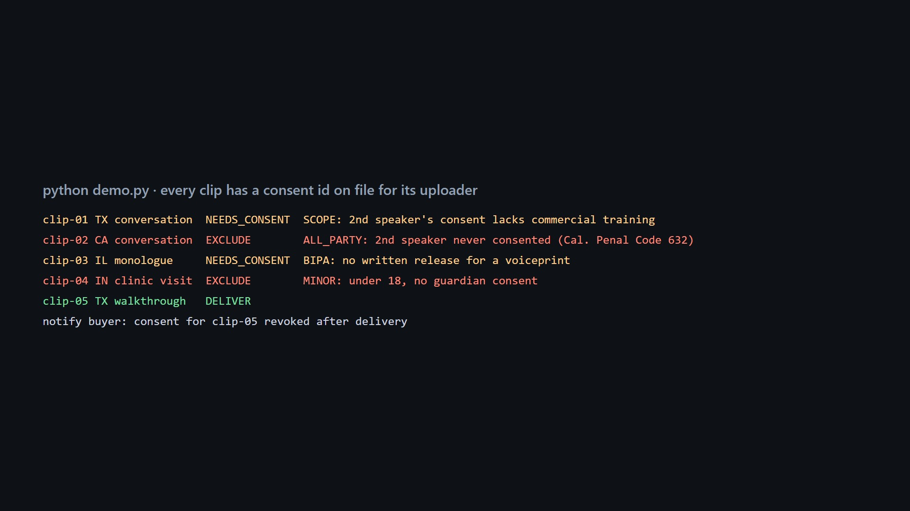

# A rights-trail check for every clip in a training-data delivery

Unofficial prototype by Kushagra Pratap Singh. Not affiliated with Luel. Not legal advice.

Luel sells "rights-cleared multimodal training data", and every dataset ships with "consent evidence, chain-of-title, and QA logs" ([YC](https://www.ycombinator.com/companies/luel)). Its 900,000+ contributors record tasks like "a natural, unscripted conversation with two people you know" ([contribute](https://luel.ai/contribute)). So a clip's rights depend on more than the uploader's consent:
- the **second speaker** (and anyone on camera);
- whether each consent's **scope** covers this buyer's use;
- whether it was **revoked** before delivery;
- **where** it was recorded (all-party-consent states);
- **Illinois** biometric rules for voice and face;
- **health** conversations;
- **minors**;
- **duplicate uploads** of the same audio.

A "consent id on file" check sees none of that. A dataset's licence is only as wide as the narrowest consent in it.



## What it does (`rights/`, stdlib)
`check(clips, consents, persons, order)` checks every person in every clip against the buyer's uses and delivery date. Each clip gets **DELIVER / NEEDS_CONSENT / EXCLUDE**, with reasons that name their source:

| code | rule |
|---|---|
| MISSING_PARTY | a recorded person has no consent (looked up by person, so consent filed under another contributor's account counts) |
| ALL_PARTY | conversation recorded in an all-party-consent state (CA, FL, IL, MD, MA, MT, NH, PA, WA) without every speaker's *prior* consent → EXCLUDE |
| SCOPE | consent doesn't cover the order's uses (commercial training, voice synthesis, redistribution) |
| REVOKED | withdrawn before delivery → EXCLUDE; withdrawn *after* → delivered, and a **notify-buyer** entry |
| BIPA | Illinois voice/face without a written release naming purpose and term (740 ILCS 14/15(b)) |
| HEALTH | health conversation without explicit health-data consent (GDPR Art. 9(2)(a) / DPDP Act s.6) |
| MINOR | under 18 at recording without guardian consent (18th birthday on the recording day passes) |
| CONSENT_AFTER_RECORDING | consent signed after the recording |
| TITLE_CONFLICT | the same audio uploaded by two contributors |

The output also includes a **manifest**: delivered/held counts, the licence scope the delivered clips actually cover, and revocations to send to the buyer.

```
$ python demo.py
  clip-01 TX conversation    NEEDS_CONSENT   SCOPE      B: missing commercial_training
  clip-02 CA conversation    EXCLUDE         ALL_PARTY  D: recorded in an all-party-consent state without every speaker's prior consent
  clip-03 IL monologue       NEEDS_CONSENT   BIPA       E: Illinois biometric identifier without a written release (740 ILCS 14/15(b))
  clip-04 IN clinic visit    EXCLUDE         MINOR      F: under 18 at recording without guardian consent
  clip-05 TX walkthrough     DELIVER
Manifest: 1 delivered, 4 held
  notify buyer: A revoked on 2026-11-02 (after delivery) for clip-05 TX walkthrough
```

## Results
**Held-out:** [`heldout/config.json`](heldout/config.json), frozen in git (commit `13e2264`) before the first run. A different order and network: India/Germany health conversations, an Illinois-heavy US mix, more two-person conversations and faces, a buyer who also wants voice synthesis and redistribution. 10 deliveries, 3,190 clips.

| | clips with a rights gap delivered | clean clips held |
|---|---|---|
| "consent id on file for the uploader" | 1,814 / 1,814 | 0 / 1,376 |
| **this check, first run** | **0 / 1,814** (all 9 kinds, right reason) | **0 / 1,376** |

After the first run I changed the revocation feed to list only clips the buyer actually received. It had also been listing held clips. This doesn't change any decision.

Dev: 0 delivered, 0 held. One dev-found generator bug: some "look-alike" adults were really 17, and the checker was right.

## Honest limits
- **Near-circular.** The data is structured and I wrote both the generator and the checker. The numbers show the rules are wired correctly and the baseline gap, not robustness.
- **The hard real problem is upstream:** knowing *who* is in a clip. That means speaker diarization and face clustering resolved to consented person ids. This assumes it's given. A clip whose speaker count disagrees with its consent list is the next check to add.
- **Jurisdiction rules are simplified** (US all-party states as commonly listed, BIPA, GDPR Art. 9, DPDP). Real rules have exceptions and need counsel; every reason names its source so counsel can check it.

## Run
```
python demo.py
python evaluate.py heldout     # first run kept in out/heldout_first_run.json
python -m pytest -q            # 6 tests, stdlib only
```
